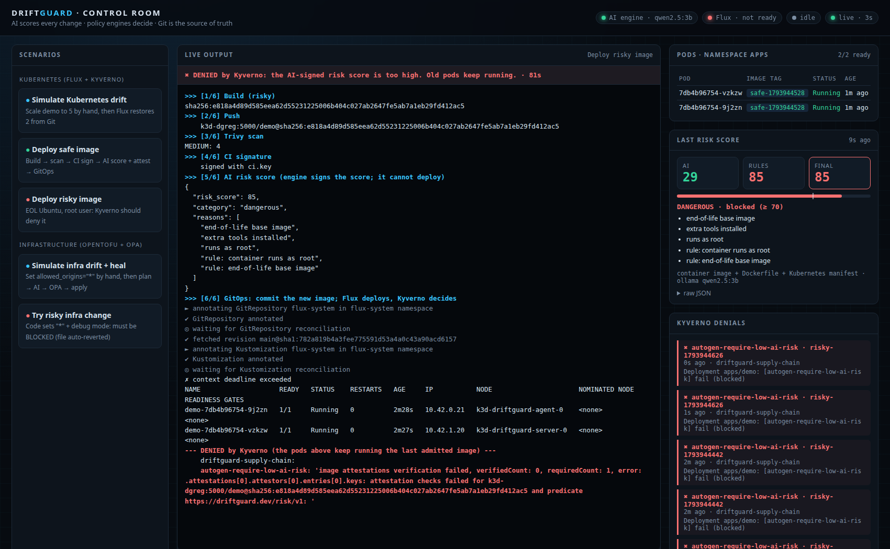

# DriftGuard: AI-Guardrailed GitOps Platform (open-source edition)

A self-healing GitOps platform where **an AI scores every change** and **policy engines decide**.
The AI can sign a risk score, but it has no rights to deploy anything.

The AI engine runs a **free, local open-source LLM** through Ollama (`qwen2.5:3b` by default), so there
is no API bill and no change data leaves the machine. The Claude API is supported as an optional backend
(`DRIFTGUARD_LLM=claude`), and `DRIFTGUARD_LLM=rules` runs with fixed rules only.

| Capability | How |
| --- | --- |
| Kubernetes drift self-healing | FluxCD re-applies Git and reverts manual `kubectl` changes |
| Infrastructure drift detection | `tofu plan -detailed-exitcode`, then AI score, then OPA gate, then apply |
| AI risk scoring | FastAPI + local LLM via Ollama (JSON-schema structured output, fail-closed); optional Claude API |
| Admission control | Kyverno verifies the CI signature and the AI-signed risk attestation (< 70) |
| Supply chain | Trivy scan + cosign signatures/in-toto attestations |
| Runtime detection (optional) | Falco |
| Demo control room | `dashboard/`: one web page with a button per scenario, live output and live cluster state |

## Architecture

```
git push -> scripts/build.sh: build -> push -> Trivy -> cosign sign (CI key)
                                   -> AI engine: LLM score + fixed rules -> cosign attest (AI key)
                                   -> commit image digest to Git
Flux pulls Git -> Kubernetes API -> Kyverno: CI signature valid AND risk_score < 70 ? admit : deny

kubectl edit (drift) -> scripts/plan.sh: tofu plan -> AI score -> conftest (OPA) -> tofu apply | BLOCKED
```

## Design decisions
1. **The AI has no execution authority.** The engine never calls the Kubernetes API or writes to Git.
2. **The AI can only tighten.** Fixed rules always run and the final score is `max(AI, rules)`; fixed OPA
   and Kyverno rules run as well. (In the recorded demo the small local model under-rated a `"*"` CORS
   change at 30; the rules scored it 85 and it was blocked.)
3. **It fails closed.** If the engine or the LLM errors, the score is 100 and the change is blocked.
4. **Secrets stay local.** Sensitive plan values are masked before scoring, and the default LLM is local.
5. **Change content is untrusted data**, so prompt injection inside a change can't loosen a policy.

## Results
A full recorded run (Flux self-heal, safe image admitted, risky image denied by Kyverno, infra drift
healed, risky infra change BLOCKED, Falco alert, every dashboard button) is in
**[docs/demo-output.md](docs/demo-output.md)**.



## Quick start
```bash
bash scripts/install-tools.sh
bash scripts/setup-cluster.sh                 # k3d cluster + local registry k3d-dgreg:5000 + Kyverno
export GITHUB_TOKEN=$(gh auth token) GITHUB_USER=$(gh api user --jq .login)
flux bootstrap github --owner=$GITHUB_USER --repository=driftguard --personal --path=clusters/dev
bash scripts/make-keys-and-policy.sh          # ci.key / ai.key (git-ignored) + Kyverno policy
ollama pull qwen2.5:3b                        # local LLM, runs on CPU or GPU
bash scripts/start-demo.sh                    # AI engine (:8088) + control room (:8090)
```
Then either open **http://localhost:8090** and use the buttons, or run the scenarios by hand:
```bash
bash scripts/build.sh safe     # admitted
bash scripts/build.sh risky    # denied by Kyverno (require-low-ai-risk); old pods keep running
bash scripts/plan.sh           # infrastructure drift -> AI -> OPA -> heal
```

### Running the engine by hand
```bash
python3 -m venv ~/.venvs/driftguard && ~/.venvs/driftguard/bin/pip install fastapi uvicorn
cd engine && DRIFTGUARD_LLM=ollama ~/.venvs/driftguard/bin/uvicorn app:app --port 8088
# optional Claude backend: pip install anthropic; export ANTHROPIC_API_KEY=...; DRIFTGUARD_LLM=claude
```
The engine listens on **8088** (8080 is often taken by Jenkins); scripts read `ENGINE_URL`
(default `http://localhost:8088`).

### Local-environment notes
- Docker only allows plain-HTTP pushes to `localhost`, so `build.sh` pushes through `localhost:5000`
  and deploys the identical digest as `k3d-dgreg:5000/...` (the name the cluster resolves).
- cosign v2 needs `--allow-http-registry` for the plain-HTTP local registry.
- Kyverno 1.19 enables insecure registries with `features.registryClient.allowInsecure=true`.
- The safe image uses `nginx-unprivileged:1.31-alpine-slim`, which had no CRITICAL/HIGH CVEs when recorded.

## Roadmap (production version)
Gitea, Harbor, Jenkins (pods log in to OpenBao with their ServiceAccount tokens: no static secrets),
Atlantis PR workflow, OpenBao Transit-held signing keys, the engine running inside the cluster with zero RBAC,
HA cluster with TLS everywhere, migration from `kyverno.io/v1 ClusterPolicy` to `ImageValidatingPolicy`.
