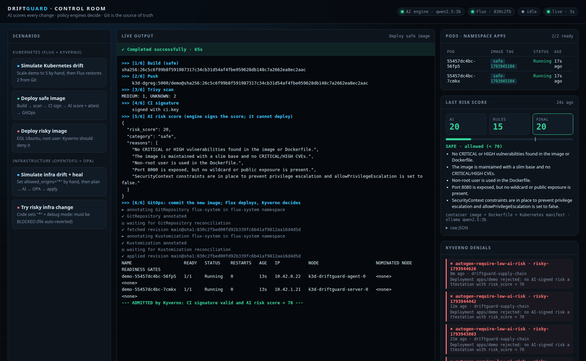
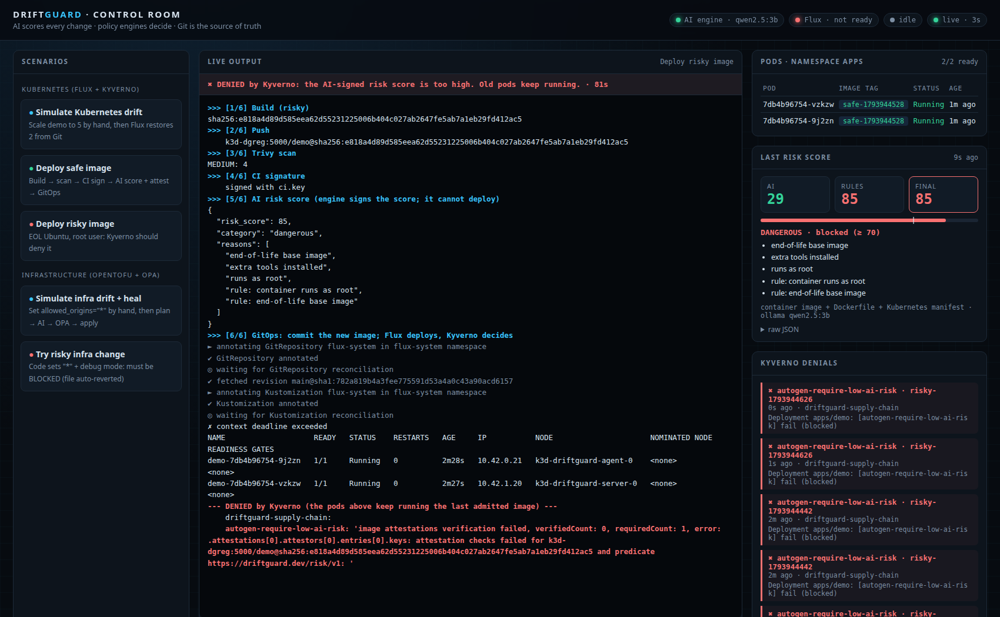
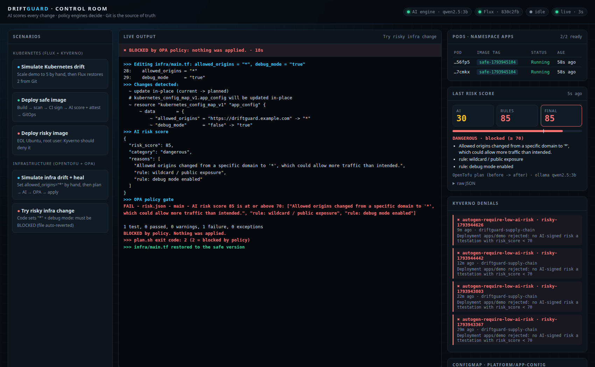

# DriftGuard demo output

Recorded on 2026-11-06 on a local k3d cluster (k3s v1.35, Kyverno 1.19.2, Flux v2.10.0, Falco 0.45.2).
AI engine: local **Ollama `qwen2.5:3b`** (CPU), fixed rules always on, final score = max(AI, rules).

## 1. Kubernetes drift self-healing (Flux)
A manual `kubectl scale` is drift; Flux re-applies Git and the replicas return to 2.
```
$ kubectl -n apps scale deploy demo --replicas=5
deployment.apps/demo scaled
NAME   READY   UP-TO-DATE   AVAILABLE   AGE
demo   5/5     5            5           24m
$ flux reconcile kustomization flux-system --with-source
✔ applied revision main@sha1:00769021ffcc241c00466bd45c6b6df43c7ae9a1
$ kubectl -n apps get deploy demo
NAME   READY   UP-TO-DATE   AVAILABLE   AGE
demo   2/2     2            2           24m
```

## 2. Safe image: signed by CI, scored by AI, admitted by Kyverno
```
$ bash scripts/build.sh safe
>>> [1/6] Build (safe)
sha256:c8c94ce306513402d8668293ceaa8321338b515aeaa7017646aec9c1fb415388
>>> [2/6] Push
    k3d-dgreg:5000/demo@sha256:c8c94ce306513402d8668293ceaa8321338b515aeaa7017646aec9c1fb415388
>>> [3/6] Trivy scan
MEDIUM: 1, UNKNOWN: 2
>>> [4/6] CI signature
    signed with ci.key
>>> [5/6] AI risk score (engine signs the score; it cannot deploy)
{
  "risk_score": 29,
  "category": "safe",
  "reasons": [
    "Uses a non-root user in Dockerfile",
    "No wildcard or public exposure in Kubernetes manifest",
    "No known vulnerabilities in the image"
  ]
}
>>> [6/6] GitOps: commit the new image; Flux deploys, Kyverno decides
► annotating GitRepository flux-system in flux-system namespace
✔ GitRepository annotated
◎ waiting for GitRepository reconciliation
✔ fetched revision main@sha1:d5c326f67ee6245c88426cd0134394c0c5b5ff82
► annotating Kustomization flux-system in flux-system namespace
✔ Kustomization annotated
◎ waiting for Kustomization reconciliation
✔ applied revision main@sha1:d5c326f67ee6245c88426cd0134394c0c5b5ff82
NAME                    READY   STATUS    RESTARTS   AGE   IP           NODE                      NOMINATED NODE   READINESS GATES
demo-67b4d6bfc9-5sztt   1/1     Running   0          20s   10.42.1.13   k3d-driftguard-server-0   <none>           <none>
demo-67b4d6bfc9-pf4jw   1/1     Running   0          17s   10.42.0.16   k3d-driftguard-agent-0    <none>           <none>
--- recent admission events ---
```

## 3. Risky image: denied by Kyverno (`require-low-ai-risk`), old pods keep running
The image is still signed by CI, so `require-ci-signature` passes. The AI-signed risk score is 85,
so the attestation condition `risk_score < 70` fails and the Deployment update is rejected.
```
$ bash scripts/build.sh risky
>>> [1/6] Build (risky)
sha256:4e14bcbda2dc0a8db3d6b8bc8290eb620e1080cba4cb822384902155b2b3c6ea
>>> [2/6] Push
    k3d-dgreg:5000/demo@sha256:4e14bcbda2dc0a8db3d6b8bc8290eb620e1080cba4cb822384902155b2b3c6ea
>>> [3/6] Trivy scan
MEDIUM: 4
>>> [4/6] CI signature
    signed with ci.key
>>> [5/6] AI risk score (engine signs the score; it cannot deploy)
{
  "risk_score": 85,
  "category": "dangerous",
  "reasons": [
    "end-of-life base image",
    "extra tools installed",
    "runs as root",
    "rule: container runs as root",
    "rule: end-of-life base image"
  ]
}
>>> [6/6] GitOps: commit the new image; Flux deploys, Kyverno decides
► annotating GitRepository flux-system in flux-system namespace
✔ GitRepository annotated
◎ waiting for GitRepository reconciliation
✔ fetched revision main@sha1:6453c88c72e4f6c5534013fc9d39841cb12c189d
► annotating Kustomization flux-system in flux-system namespace
✔ Kustomization annotated
◎ waiting for Kustomization reconciliation
✗ context deadline exceeded
NAME                    READY   STATUS    RESTARTS   AGE   IP           NODE                      NOMINATED NODE   READINESS GATES
demo-67b4d6bfc9-5sztt   1/1     Running   0          10m   10.42.1.13   k3d-driftguard-server-0   <none>           <none>
demo-67b4d6bfc9-pf4jw   1/1     Running   0          10m   10.42.0.16   k3d-driftguard-agent-0    <none>           <none>
--- DENIED by Kyverno (the pods above keep running the last admitted image) ---
    driftguard-supply-chain:
    autogen-require-low-ai-risk: 'image attestations verification failed, verifiedCount: 0, requiredCount: 1, error: .attestations[0].attestors[0].entries[0].keys: attestation checks failed for k3d-dgreg:5000/demo@sha256:4e14bcbda2dc0a8db3d6b8bc8290eb620e1080cba4cb822384902155b2b3c6ea and predicate https://driftguard.dev/risk/v1: '
```

## 4. Safe image again: admitted
```
$ bash scripts/build.sh safe
>>> [1/6] Build (safe)
sha256:c25a068f07b0deee1766369478183d605eba6126f456dbdcefbbd67c9c41c5bb
>>> [2/6] Push
    k3d-dgreg:5000/demo@sha256:c25a068f07b0deee1766369478183d605eba6126f456dbdcefbbd67c9c41c5bb
>>> [3/6] Trivy scan
MEDIUM: 1, UNKNOWN: 2
>>> [4/6] CI signature
    signed with ci.key
>>> [5/6] AI risk score (engine signs the score; it cannot deploy)
{
  "risk_score": 20,
  "category": "safe",
  "reasons": [
    "The image is from a maintained repository with a non-root user, no CRITICAL or HIGH vulnerabilities, and uses a secure port (8080). The Kubernetes manifest specifies a secure deployment and service configuration without exposing any wildcards or public IPs."
  ]
}
>>> [6/6] GitOps: commit the new image; Flux deploys, Kyverno decides
► annotating GitRepository flux-system in flux-system namespace
✔ GitRepository annotated
◎ waiting for GitRepository reconciliation
✔ fetched revision main@sha1:00769021ffcc241c00466bd45c6b6df43c7ae9a1
► annotating Kustomization flux-system in flux-system namespace
✔ Kustomization annotated
◎ waiting for Kustomization reconciliation
✔ applied revision main@sha1:00769021ffcc241c00466bd45c6b6df43c7ae9a1
NAME                   READY   STATUS    RESTARTS   AGE   IP           NODE                      NOMINATED NODE   READINESS GATES
demo-746988b7c-bmnvn   1/1     Running   0          13s   10.42.1.14   k3d-driftguard-server-0   <none>           <none>
demo-746988b7c-qw46v   1/1     Running   0          12s   10.42.0.17   k3d-driftguard-agent-0    <none>           <none>
--- ADMITTED by Kyverno: CI signature valid and AI risk score < 70 ---
```

## 5. Infrastructure: first plan creates the resources
```
$ bash scripts/plan.sh
>>> Changes detected:
  # kubernetes_config_map_v1.app_config will be created
  # kubernetes_namespace_v1.platform will be created
>>> AI risk score
{
  "risk_score": 30,
  "category": "needs_review",
  "reasons": [
    "allowed_origins"
  ]
}
>>> OPA policy gate

1 test, 1 passed, 0 warnings, 0 failures, 0 exceptions

1 test, 1 passed, 0 warnings, 0 failures, 0 exceptions
>>> Gate passed: applying
kubernetes_namespace_v1.platform: Creating...
kubernetes_namespace_v1.platform: Creation complete after 0s [id=platform]
kubernetes_config_map_v1.app_config: Creating...
kubernetes_config_map_v1.app_config: Creation complete after 0s [id=platform/app-config]

Apply complete! Resources: 2 added, 0 changed, 0 destroyed.
```

## 6. Infrastructure drift healed
Someone loosens the CORS setting by hand. The plan reverts it to the stricter value, the AI scores the
change below 70, OPA lets it through, and OpenTofu applies.
```
$ kubectl -n platform patch configmap app-config --type merge -p '{"data":{"allowed_origins":"*"}}'
configmap/app-config patched
{"allowed_origins":"*","debug_mode":"false"}
$ bash scripts/plan.sh
>>> Changes detected:
  ~ update in-place (current -> planned)
  # kubernetes_config_map_v1.app_config will be updated in-place
  ~ resource "kubernetes_config_map_v1" "app_config" {
      ~ data        = {
          ~ "allowed_origins" = "*" -> "https://driftguard.example.com"
>>> AI risk score
{
  "risk_score": 30,
  "category": "needs_review",
  "reasons": [
    "Wildcard allowed origins ('*') changed to a specific origin ('https://driftguard.example.com'), debug_mode remains unchanged"
  ]
}
>>> OPA policy gate

1 test, 1 passed, 0 warnings, 0 failures, 0 exceptions

1 test, 1 passed, 0 warnings, 0 failures, 0 exceptions
>>> Gate passed: applying
kubernetes_config_map_v1.app_config: Modifying... [id=platform/app-config]
kubernetes_config_map_v1.app_config: Modifications complete after 0s [id=platform/app-config]

Apply complete! Resources: 0 added, 1 changed, 0 destroyed.
```

## 7. Risky infrastructure change in code: BLOCKED
`infra/main.tf` temporarily set to `allowed_origins = "*"` and `debug_mode = "true"` (reverted afterwards).
```
$ bash scripts/plan.sh   # exit code 2
>>> Changes detected:
  ~ update in-place (current -> planned)
  # kubernetes_config_map_v1.app_config will be updated in-place
  ~ resource "kubernetes_config_map_v1" "app_config" {
      ~ data        = {
          ~ "allowed_origins" = "https://driftguard.example.com" -> "*"
          ~ "debug_mode"      = "false" -> "true"
>>> AI risk score
{
  "risk_score": 85,
  "category": "dangerous",
  "reasons": [
    "Allowed origins changed from a specific domain to '*', which could allow more traffic than intended.",
    "rule: wildcard / public exposure",
    "rule: debug mode enabled"
  ]
}
>>> OPA policy gate
FAIL - risk.json - main - AI risk score 85 is at or above 70: ["Allowed origins changed from a specific domain to '*', which could allow more traffic than intended.", "rule: wildcard / public exposure", "rule: debug mode enabled"]

1 test, 0 passed, 0 warnings, 1 failure, 0 exceptions
BLOCKED by policy. Nothing was applied.
```
Afterwards, with `main.tf` reverted:
```
$ bash scripts/plan.sh
No drift: infrastructure matches code.
```

## 8. Runtime detection (Falco, optional)
Falco 0.45.2 via Helm with the `modern_ebpf` driver. The demo app runs as non-root, so reading `/etc/shadow`
is refused by the kernel; the attacker's follow-up search for private keys is flagged by Falco.
```
$ bash scripts/falco.sh
>>> Simulating an attacker inside the app: reading /etc/shadow and hunting for private keys
05:50:06.472870877: Warning Grep private keys or passwords activities found | evt_type=execve user=<NA> user_uid=101 user_loginuid=-1 process=find proc_exepath=/bin/busybox parent=sh command=find / -name id_rsa terminal=0 exe_flags=EXE_LOWER_LAYER container_id=7583f6b24eff container_name=demo ...
05:50:36.250056836: Warning Grep private keys or passwords activities found | evt_type=execve user=<NA> user_uid=101 user_loginuid=-1 process=find proc_exepath=/bin/busybox parent=<NA> command=find / -name id_rsa terminal=0 exe_flags=EXE_LOWER_LAYER container_id=7583f6b24eff container_name=demo ...
```

## 9. Control-panel dashboard (`bash scripts/start-demo.sh` → http://localhost:8090)
Every button was clicked in a real (headless) Chrome and also driven through the API:

| Button | Result | Time |
| --- | --- | --- |
| Simulate Kubernetes drift | replicas 5 → 2 after `flux reconcile`, completed | ~20 s |
| Deploy safe image | AI 20 / rules 15 → ADMITTED, new pods Running | ~45-65 s |
| Deploy risky image | AI 29 / rules 85 → DENIED by `autogen-require-low-ai-risk`, old pods kept running | ~85 s |
| Simulate infra drift + heal | AI 30 / rules 15 → gate passed, configmap restored | ~20 s |
| Try risky infra change | AI 30 / rules 85 → BLOCKED by OPA, `main.tf` restored | ~15 s |

A second press while an action runs returns HTTP 409 and all buttons are disabled in the page.

Note the infra rows: the small local model under-rates `allowed_origins="*"` (AI 30), but the fixed rules
score it 85 and the final score is `max(AI, rules)`, so it is still blocked. The AI can only tighten.




